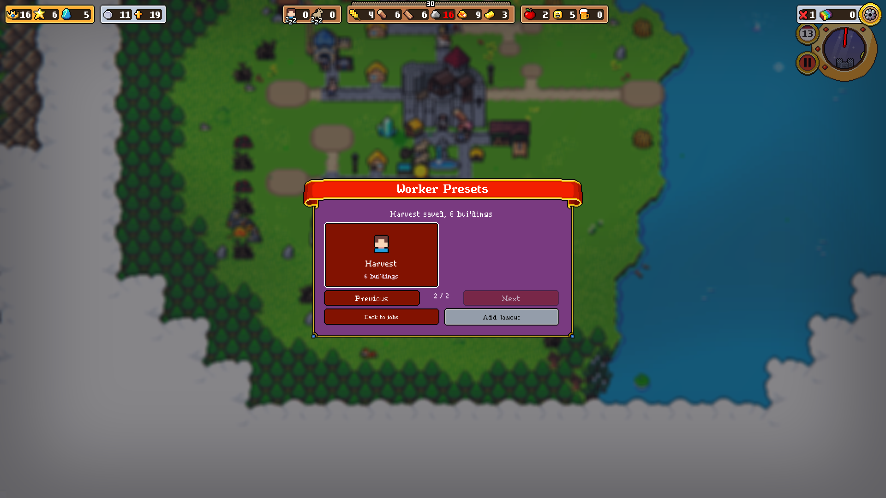
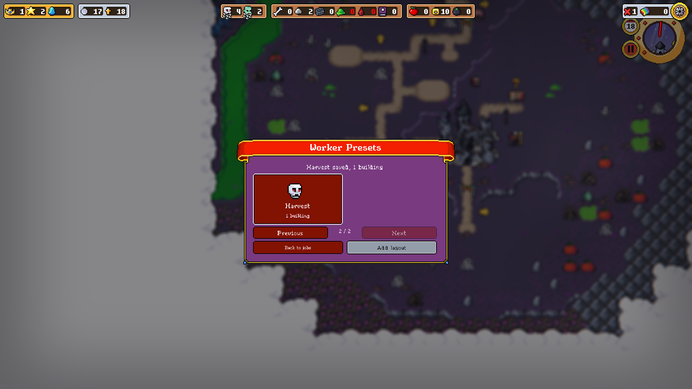
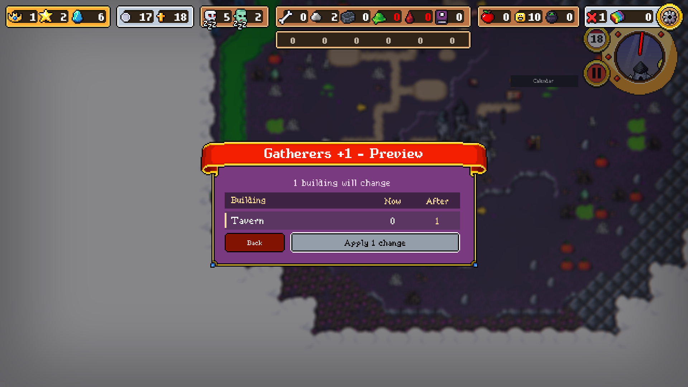

# Worker Presets

Save named staffing layouts for a kingdom run and switch between them from a building’s job assignment panel. Preview each change before applying it through the game’s own worker controls.

## Features

- Start with **Layout 1** and **Layout 2**. Select **Add layout** to create more, and use **Previous** and **Next** to browse them.
- Open a layout and choose **Remove layout** to delete it from the picker after confirmation.
- Compare **Now** and **After** counts. Duplicate buildings show their plot coordinates, so two Lumberyards can have different targets.
- See worker and carrier shortfalls before applying. Newly built workplaces keep their current staffing. Demolished buildings are skipped, even if you rebuild the same type on the same plot.
- Carry your layouts forward with the kingdom’s next normal save and **Continue**.

## How to Use

1. Open a building’s job assignment panel. Select **Presets** beside the job count, or **Worker Presets** below a longer job label.
2. Choose a layout or select **Add layout**, then select **Save current staffing**. Overwriting a saved layout asks for confirmation. **Rename** offers a controller-friendly name picker and a text field for custom names.
3. Choose **Preview layout**. Check the plot, the **Now** and **After** columns, and any shortage. You can apply a layout with more jobs than available people. The game assigns the staff it has.
4. Select **Apply** with the displayed change count to confirm. **Back** leaves staffing as it was and returns one screen at a time.

## Screenshots

## Compatibility

Supports Super Fantasy Kingdom **0.8.070** in Human and Undead kingdoms. Compatible with the other [GKJ mods](https://thunderstore.io/c/super-fantasy-kingdom/p/GKJ/).

- [Production Bottlenecks](https://thunderstore.io/c/super-fantasy-kingdom/p/GKJ/ProductionBottlenecks/) can still focus the selected Lumberyard when two share the same name.
- [Pin a Build Cost](https://thunderstore.io/c/super-fantasy-kingdom/p/GKJ/PinABuildCost/) shares the building panel. Its resource pin and the native assignment controls stay accessible.
- The staffing preview leaves the [Daybook](https://thunderstore.io/c/super-fantasy-kingdom/p/GKJ/Daybook/) counters and [Visitor Calendar](https://thunderstore.io/c/super-fantasy-kingdom/p/GKJ/VisitorCalendar/) visible.

- These community mods can share the same profile. [Achievement Enabler](https://thunderstore.io/c/super-fantasy-kingdom/p/ownlyme/AchievementEnabler/), [Bakery Uses Wheat](https://thunderstore.io/c/super-fantasy-kingdom/p/ownlyme/BakeryUsesWheat/), [More Relics](https://thunderstore.io/c/super-fantasy-kingdom/p/ownlyme/MoreRelics/), [Right Click Skip](https://thunderstore.io/c/super-fantasy-kingdom/p/ownlyme/RightClickSkip/), and [Tavern Food Priorities](https://thunderstore.io/c/super-fantasy-kingdom/p/ownlyme/TavernFoodPriorities/).

## Installation

Install **Worker Presets** from the Super Fantasy Kingdom community in your Thunderstore-compatible mod manager, then launch the game with that profile.

For manual installation, install [BepInExPack](https://thunderstore.io/c/super-fantasy-kingdom/p/BepInEx/BepInExPack/) and [HideManagerGameObject Config](https://thunderstore.io/c/super-fantasy-kingdom/p/BepInEx/HideManagerGameObject_Config/). Copy `plugins/WorkerPresets.dll` from the ZIP to `BepInEx/plugins/GKJ-WorkerPresets/WorkerPresets.dll`.

## Support

[Support GKJ Games on Ko-fi](https://ko-fi.com/gkj_games)
