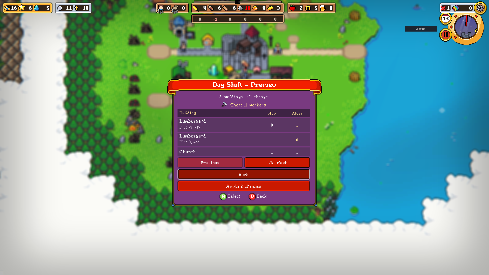
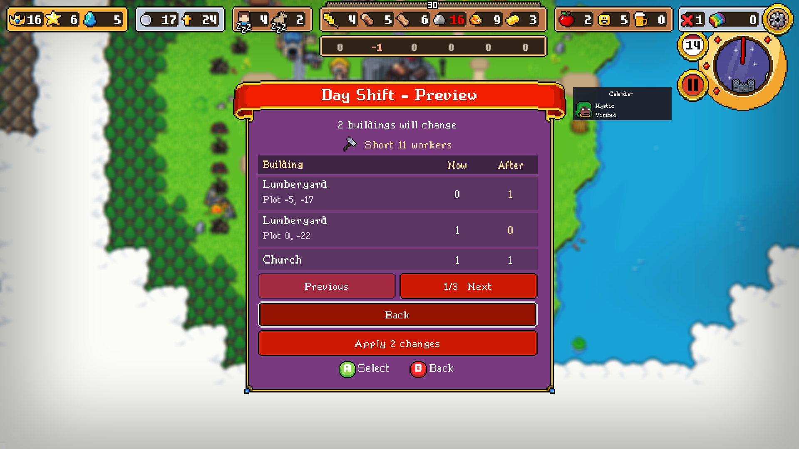

# Worker Presets

Save two named staffing layouts for a kingdom run, then switch between them from a building’s job assignment panel. Preview each change before applying it through the game’s own worker controls.

## Features

- Keep two layouts, initially **Day Shift** and **Night Shift**. Rename them to suit your kingdom.
- Compare **Now** and **After** counts. Duplicate buildings show their plot coordinates, so two Lumberyards can have different targets.
- See worker and carrier shortfalls before applying. Newly built workplaces keep their current staffing. Demolished buildings are skipped, even if you rebuild the same type on the same plot.
- Carry both layouts forward with the kingdom’s next normal save and **Continue**.

## How to Use

1. Open a building’s job assignment panel. Select **Presets** beside the job count, or **Worker Presets** below a longer job label.
2. Choose a slot and select **Save current staffing**. Overwriting a saved layout asks for confirmation. **Rename** offers a controller-friendly name picker and a text field for custom names.
3. Choose **Preview layout**. Check the plot, the **Now** and **After** columns, and any shortage. You can apply a layout with more jobs than available people. The game assigns the staff it has.
4. Select **Apply** with the displayed change count to confirm. **Back** leaves staffing as it was and returns one screen at a time.

## Screenshots

At 1×, Day Shift would move one assignment between two Lumberyards. Their plot coordinates distinguish them.

At 1.5× after Continue, the preview shows an 11-worker shortfall. Back has focus, and the resource counters and Visitor Calendar remain visible.

## Compatibility

- Works with Super Fantasy Kingdom **0.8.068** and the other [GKJ mods](https://thunderstore.io/c/super-fantasy-kingdom/p/GKJ/).
- The Presets button shares the building panel with [Pin a Build Cost](https://thunderstore.io/c/super-fantasy-kingdom/p/GKJ/PinABuildCost/) and [Production Bottlenecks](https://thunderstore.io/c/super-fantasy-kingdom/p/GKJ/ProductionBottlenecks/). The staffing preview leaves the [Daybook](https://thunderstore.io/c/super-fantasy-kingdom/p/GKJ/Daybook/) resource counters and [Visitor Calendar](https://thunderstore.io/c/super-fantasy-kingdom/p/GKJ/VisitorCalendar/) prompt accessible.
- Presets use the game’s staffing rules. Mods that change workforce availability can affect how many jobs are filled. New buildings keep their current staffing and demolished buildings are skipped.
- These community mods can share the same profile. [Achievement Enabler](https://thunderstore.io/c/super-fantasy-kingdom/p/ownlyme/AchievementEnabler/), [Bakery Uses Wheat](https://thunderstore.io/c/super-fantasy-kingdom/p/ownlyme/BakeryUsesWheat/), [More Relics](https://thunderstore.io/c/super-fantasy-kingdom/p/ownlyme/MoreRelics/), [Right Click Skip](https://thunderstore.io/c/super-fantasy-kingdom/p/ownlyme/RightClickSkip/), and [Tavern Food Priorities](https://thunderstore.io/c/super-fantasy-kingdom/p/ownlyme/TavernFoodPriorities/).

## Installation

Install **Worker Presets** from the Super Fantasy Kingdom community in your Thunderstore-compatible mod manager, then launch the game with that profile.

For manual installation, install [BepInExPack](https://thunderstore.io/c/super-fantasy-kingdom/p/BepInEx/BepInExPack/) and [HideManagerGameObject Config](https://thunderstore.io/c/super-fantasy-kingdom/p/BepInEx/HideManagerGameObject_Config/). Copy `plugins/WorkerPresets.dll` from the ZIP to `BepInEx/plugins/GKJ-WorkerPresets/WorkerPresets.dll`.

## Support

[Support GKJ Games on Ko-fi](https://ko-fi.com/gkj_games)
